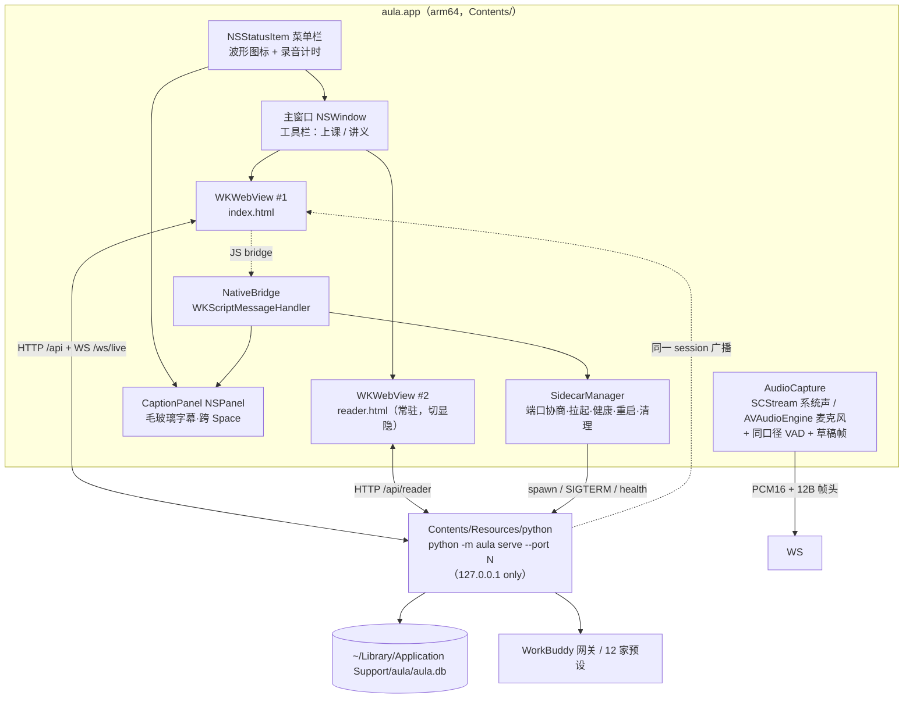

# aula 整合为 macOS 应用 · 架构方案

> 基于仓库实测（v0.7.1，Python 10.1k 行 + Swift 1.3k 行 + JS 2.7k 行，227 pytest 全绿）。凡标「需验证」的是无法从代码确定、必须花 ≤1 小时实测的点，不给假答案。
>
> 方案日期：2026-10-23　｜　架构师：高见远　｜　状态：~~待用户拍板~~ **用户已拍板走 B 路线（原生重写 UI），本文的 A 路线分析保留作决策依据**
>
> **决策记录（2026-10-23）**：用户选 B（Swift 原生重写 UI + Python sidecar）、自签证书只自用、whisper 模型首启下载 + 仅 arm64。
> B 路线的四项地基验证已实测通过（PDFKit 替代 pdf.js 文本层、pbs+ctranslate2 内嵌、原生 WS 直连、自签保 TCC），工期重估 30–44 人日（非 3 倍而是 1.5–2 倍）。
> 详见 **[b-route-validation.md](b-route-validation.md)**；本文 §3 对 B 的否决结论按新证据已部分失效——PDFKit 能承接 pdf.js 的算法而非重写设计。

## 1. TL;DR

1. **推荐路线 A：WKWebView 壳 + 内嵌 Python sidecar**——现有两套工作区、实时链路、227 项测试全部零改动留用，新增代码全在壳层（8 个 Swift 文件 + 1 个构建脚本），约 5–7 人日到 P0 可用。
2. **Python 用 python-build-standalone 内嵌（onedir 布局），不用 PyInstaller 单文件**；whisper 继续 faster-whisper（ASR 本来就是可插拔 provider，换引擎不阻塞整合）；whisper.cpp / Apple Speech 只做 P1 的 1 小时 CER 对比实验。
3. **不上沙盒、不公证**（个人自用）：arm64 单架构、最低 macOS 13、自签证书固定 designated requirement，从根上解决"每次重编译丢屏幕录制权限"。

## 2. 现状盘点

| 模块 | 技术 / 形态 | 规模 | 迁 Mac 风险 | 说明 |
|---|---|---|---|---|
| `aula/server.py` | FastAPI + uvicorn，127.0.0.1:8780，WS `/ws/live` 二进制帧 | 700 行 | **中** | 需加端口协商、READY 握手、父进程守护；业务逻辑不动 |
| WS 协议 | `<III` 12 字节头 + PCM16，下行 7 种 JSON | — | **低** | 协议刻意做薄，浏览器/原生/Swift 同口径，壳层不用碰 |
| `asr.py` | faster-whisper small int8 / 云端 / mock，**已是可插拔 provider** | 389 行 | **中** | 打包 ctranslate2 是唯一硬骨头（C++ 扩展） |
| `translate.py` + `mt.py` + `llm.py` | google_free 粗译 0.2s → LLM 精译 2.5s；7 引擎 | 749 行 | **低** | 纯网络调用，无平台依赖 |
| `store.py` | 标准库 sqlite3，`~/.aula/aula.db` | 319 行 | **低** | pbs 自带 `_sqlite3`，不用额外打包 |
| `config.py` | `~/.config/aula/config.json`，已有 `AULA_*` 环境变量覆盖（含 `AULA_DATA_DIR` / `AULA_CONFIG`） | 307 行 | **低** | **迁移只需注入环境变量，不用改代码**——这是现有设计送的红利 |
| `static/index.html` + `app.js` | 手写原生 JS + AudioWorklet VAD | 194+1261 | **中** | 录音状态活在页面 JS 里 → 切页面即断流，直接决定窗口组织方式 |
| `static/reader.html` + `reader.js` | pdf.js 双语对照 + 圈选提问 | 187+1416 | **中** | PDFKit 无法替代 pdf.js 文本层，原生重写代价极高 |
| `static/vendor/pdf.*.mjs` | vendored pdf.js（ES module worker） | — | 中·需验证 | WKWebView 与 Safari 同引擎，module worker 预计可用，失败则退 legacy build |
| `menubar/main.swift` | AppKit 单文件：NSStatusItem + NSPanel 毛玻璃字幕 + SCK 系统音频 + VAD + 自动拉服务 | 781 行 | **低** | **已经是半个 app**，本次工作是拆分强化而非从零写 |
| `helpers/main.swift` | CLI 捕获助手，服务端 `swiftc` 现场编译后拉起 | 494 行 | **高** | 见 §4.4 R4：临时编译的二进制导致 TCC 授权挂错主体，app 内必须停用 |
| `scripts/build_menubar.sh` | swiftc 单文件 → 组 bundle → ad-hoc 签名 | 60 行 | 低 | 改造成 `build_app.sh`，加 python 环境构建与嵌套签名 |
| 测试 | pytest 227 项，TestClient 每连接独立事件循环 | — | 低 | 全绿必须保持，这是回归网 |

## 3. 路线对比

权重按「个人开发者、长期自己维护」设定：维护成本 30%、风险 20%、体验 20%、改动量 15%、交付周期 15%。评分 1–5，5 最好。

| 路线 | 改动量 | 风险 | 体验 | 维护成本 | 交付周期 | 加权 | 结论 |
|---|---|---|---|---|---|---|---|
| **A. WKWebView 壳 + Python sidecar** | 4 | 4 | 3.5 | **4.5** | 5 | **4.20** | ✅ 推荐 |
| B. SwiftUI 重写 UI + Python sidecar | 2 | 2.5 | 5 | 2 | 2 | 2.70 | 否 |
| C. 全原生（Swift + whisper.cpp + CoreML） | 1 | 1.5 | 5 | 1 | 1 | 1.90 | 否 |

**为什么否决 B**：要重写 2700 行高度调优过的 JS（AudioWorklet VAD 参数、玻璃拟态设计系统、pdf.js 文本层锚点、圈选提问）。其中讲义工作区是死结——pdf.js 的文本层 + 段落锚点 + 选中即问，用 PDFKit 重做等于重写 `reader.js` + `reader.py` 的段落映射，且质量必然退步。单人维护两套 UI 语言，维护成本直接翻倍，与"维护权重 30%"直接冲突。

**为什么否决 C**：等于把 10.1k 行 Python（含 digest 分块合成、outline 锚点、7 引擎降级链）和 227 项测试全部作废，周期 2–3 个月起。只有当目标是上架 App Store 变现时才值得，与"个人自用、预算敏感"的画像不符。

**A 的代价要认**：观感不是 100% 原生（滚动弹性、右键菜单、文本选中是 Web 味）；WebView 常驻约 300–500MB 内存。用原生壳补：原生工具栏、原生菜单、原生设置窗、原生字幕窗、原生快捷键——用户实际高频触碰的都是这些。

## 4. 推荐路线详细设计

### 4.1 应用架构图



关键结构决策（有代码依据）：
- **两个 WKWebView 常驻、切显隐而非切 URL**。录音状态（AudioWorklet 句柄）活在 `index.html` 的 JS 里，`load()` 新 URL 会销毁页面 → 上课途中去看讲义就断流。两个 WebView 各占一个进程，代价可接受。
- **音频采集逐步收归原生**。`server.py` 的 `_HUBS` 广播机制天然支持"原生采集 + Web 显示"（现在的系统声音就是这么跑的），所以壳层可以接管采集而完全不动前端渲染逻辑。
- **`/api/capture/start` 现编译 helper 的路径必须停用**（§4.4 R4），app 内改为进程内 SCStream。

### 4.2 需要修改的部分（文件级）

| 路径 | 动作 | 改什么 / 为什么 | 工作量 |
|---|---|---|---|
| `aula/app/AppDelegate.swift` | 新增 | `.regular` 激活策略、主窗口生命周期、关窗不退出、Dock 点击重开、单实例、菜单构建、睡眠唤醒钩子 | L |
| `aula/app/MainWindow.swift` | 新增 | NSWindow + 原生工具栏（分段控件切工作区、录音红点、服务状态）；最小 960×640 | M |
| `aula/app/WorkspaceWebView.swift` | 新增 | 双 WKWebView 容器、`WKUIDelegate`（麦克风/文件面板授权回调）、页面缩放、深色跟随、注入 `window.__aulaNative` | M |
| `aula/app/Sidecar.swift` | 新增 | 端口探测与协商、`Process` 拉起 pbs python、READY 握手、5s 健康轮询、崩溃退避重启（60s 内≤3 次）、stderr 落 `~/Library/Logs/aula/sidecar.log`、退出清理、pid 文件 | M |
| `aula/app/AudioCapture.swift` | 新增 | 从 `menubar/main.swift` 抽出 SCStream 系统音频 + VAD + 帧编码；P1 增加 `AVAudioEngine` 麦克风通路（复用同一 VAD 常量） | M |
| `aula/app/CaptionPanel.swift` | 新增 | 抽取现有 `CaptionWindow`；补 `collectionBehavior = [.canJoinAllSpaces, .fullScreenAuxiliary, .stationary]`（现在全屏播放器上会被挡住）、按屏幕 UUID+分辨率记忆位置、字号 ⌘±、点击穿透开关 | S |
| `aula/app/Permissions.swift` | 新增 | 首启向导：麦克风（AVCaptureDevice 请求）、屏幕录制（`CGPreflightScreenCaptureAccess` 预检 + `SCShareableContent` 触发 + 系统设置深链 + "改完需重启 app"提示） | S |
| `aula/app/NativeBridge.swift` | 新增 | JS↔原生消息：`toggleCaptions`、`pickPDF`、`revealInFinder`、`getAppInfo`、`openSettings`；只暴露白名单动作 | S |
| `aula/menubar/main.swift` | 改造 | 781 行单文件拆成上面模块，自身退化为薄入口；`ServeManager` 硬编码 venv 路径删除（这是当前"依赖 venv"痛点的根因） | M |
| `aula/helpers/main.swift` | 保留不动 | 仍服务 CLI / 浏览器模式；app 构建时**不打包**，且 app 模式下 `/api/capture/start` 返回 409 提示用原生通路 | S |
| `aula/cli.py` | 改（~40 行） | `serve` 支持 `--port 0`（内核分配）、`--no-browser`、stdout 打印 `AULA_READY port=N` 握手行、`--parent-pid` 守护、写 pid 文件 | S |
| `aula/config.py` | 改（~15 行） | 无需迁移逻辑：壳层注入 `AULA_DATA_DIR` / `AULA_CONFIG` / `AULA_APP_MODE=1` 即可；只加 `app_mode` 只读属性 | S |
| `aula/server.py` | 改（~30 行） | `/api/health` 增 `app_mode`、`pid` 字段；`/api/capture/start` 在 app 模式返回 409；启动打印 READY；`shutdown` 清理 `_CAPTURES` | S |
| `aula/static/app.js` / `index.html` / `reader.html` | 改（~60 行） | 检测 `window.__aulaNative` 时隐藏"打开浏览器/端口/如何启动"文案、导出改原生 Finder 揭示、PDF 拖放走 bridge；渲染与实时逻辑一行不动 | S |
| `scripts/build_app.sh` | 新增 | 一体化构建：下 pbs → 建 env → `pip install --no-compile` → 裁 site-packages → swiftc 多文件编译 → 组 bundle → **逐 Mach-O 签名**（.so/.dylib 先签、bundle 后签）→ ditto 出 zip/dmg | L |
| `aula/app/Info.plist`、`aula.entitlements`、`AppIcon.icns` | 新增 | 见 §4.3.3 | S |
| `tests/test_cli.py` / `test_api.py` | 改（~80 行） | 覆盖 `--port 0`、READY 行格式、`AULA_DATA_DIR` 隔离、app_mode 下 capture 409 | S |

**不改**：`asr.py` `translate.py` `mt.py` `llm.py` `store.py` `digest.py` `outline.py` `study.py` `chat.py` `reader.py` `providers.py` `chunk.py` `textclean.py`、全部 CSS、`reader.js`。这是"改动量 4 分"的底气：新增 ≈2.5k 行 Swift + 1 个脚本，存量 10k 行 Python 基本不动。

### 4.3 Mac 适配

#### 4.3.1 界面

| 项 | 方案 |
|---|---|
| 窗口组织 | 单主窗口 + 原生工具栏分段控件「上课 / 讲义」；两个 WKWebView 常驻切显隐（录音不断流）。讲义也支持独立窗口（P2），默认不拆 |
| 菜单栏 | 保留 NSStatusItem（现状已好用）：显示听课计时、开始/停止、字幕显隐、打开主窗口、设置、退出；图标随录音态变化 |
| Dock / 激活策略 | 改 `.regular`（有 Dock 图标、Cmd-Tab 可切、有应用菜单）。关窗不退出，点 Dock 重开；退出前二次确认"正在听课" |
| 全局快捷键 | ⌥⌘R 开始/停止、⌥⌘L 字幕、⌥⌘1/2 切工作区。用 **Carbon `RegisterEventHotKey`**（不需要辅助功能权限），不要 `NSEvent.addGlobalMonitorForEvents` |
| 悬浮字幕 | 现有 NSPanel 基础上：`.fullScreenAuxiliary` 才能浮在全屏 Keynote/播放器上；位置按 `NSScreen` UUID + 分辨率存 UserDefaults；默认右下角、边距 24pt；字号 3 档；一键点击穿透 |
| 深色模式 | WKWebView 自动跟随系统（CSS 已有 `prefers-color-scheme`）。设置给「跟随系统 / 强制浅色 / 强制深色」，`NSApp.appearance` + 注入 class 双保险。`prefers-reduced-transparency` 在 WebView 内生效，毛玻璃字幕窗读 `NSWorkspace.accessibilityDisplayShouldReduceTransparency` 降级为纯色 |
| 字体 | CSS 前置 `-apple-system, "PingFang SC"`；`text-rendering: optimizeLegibility`；西语重音字符系统字体已覆盖 |
| 缩放 | ⌘+/⌘−/⌘0 → `WKWebView.pageZoom`（不动 CSS 布局，避免破坏 11 个 JS 的坐标契约） |
| 多显示器 | 主窗口跟随系统；字幕窗跨 Space + 记忆；讲义 PDF 全屏用原生 fullscreen |
| 录音期间 | `ProcessInfo.beginActivity(.latencyCritical)` + `IOPMAssertion` 阻止休眠，否则合盖/待机断流 |

#### 4.3.2 Python 运行时与依赖打包

| 方案 | 产物体积（arm64，需实测） | 启动开销 | 签名影响 | 与 faster-whisper/ctranslate2 的坑 | 评价 |
|---|---|---|---|---|---|
| **PyInstaller onedir** | ~300–380MB | +0.3–0.8s | 需对 `_internal` 下每个 .dylib/.so 逐个 `codesign --options runtime`；`--deep` 不可靠 | ctranslate2 的 dylib 走 `@rpath` 未被收集（要 `--collect-all ctranslate2`）；onnxruntime provider dylib 漏收；hiddenimports 要补 `tokenizers` `av` `huggingface_hub`；分析期会误拉 uvicorn reload 依赖 | 可行但需反复试错，钩子文件要自己写 |
| **Briefcase (BeeWare)** | ~250–350MB | +0.5s | 内置签名流程较完善 | ctranslate2 / onnxruntime 不在 BeeWare 二进制支持清单，要自建 support package，工作量反超 PyInstaller | 不推荐 |
| **python-build-standalone 内嵌（推荐）** | ~90–120MB（CPython 解包）+ 依赖 ~180–250MB ≈ **300–400MB** | **+0.05s** | 透明：`Resources/python/` 目录，脚本遍历 `file` 判定 Mach-O 后逐个签名，顺序确定、可复现 | 唯一风险是 pbs 的 dylib rpath 与 wheel 内绝对路径（pbs 官方声明 relocatable；wheel `.so` 用 `@loader_path`）。**必须实测**：嵌入式解释器里 import ctranslate2 并跑一次推理 | ✅ 推荐：构建可复现、出错看得见、能直接 `Resources/python/bin/python3 -m aula serve` 手工调试 |

**具体落地**：`Contents/Resources/python/` 放 pbs `install_only` 版（**固定 3.12**，理由：cp313 的 ctranslate2 wheel 覆盖度不确定，3.12 是各轮子最稳版本）、`site-packages` 装 `fastapi uvicorn[standard] websockets numpy faster-whisper`，`--no-compile` 免 `__pycache__`，裁掉 `tests/`、`*.dist-info` 里非必需 RECORD。**whisper 模型不打包**（small int8 约 480MB，打包后 app 直奔 800MB+）：首启引导下载到 `~/Library/Application Support/aula/models`，用 `HF_HOME` 指向它，一次下载终身复用，界面给出进度与"已有缓存可跳过"。

#### 4.3.3 权限与签名

| 项 | 做法 |
|---|---|
| Info.plist | `NSMicrophoneUsageDescription`（必填，缺了静默失败）、`LSMinimumSystemVersion 13.0`、`LSMultipleInstancesProhibited true`、`LSUIElement false`、`NSSupportsAutomaticTermination false`（防 App Nap 收掉服务）、`NSAppTransportSecurity → NSAllowsLocalNetworking true`（http://127.0.0.1 保险，需验证是否必需）、`NSHighResolutionCapable` |
| 屏幕录制 | **TCC 无法用 entitlement 授予**，只能首启引导：`CGPreflightScreenCaptureAccess()` 预检 → 调 `SCShareableContent` 触发系统弹窗 → 未授权则开深链 `x-apple.systempreferences:com.apple.preference.security?Privacy_ScreenCapture` → 提示"改完请重启 aula"（SCK 权限变更须重启进程才生效） |
| Hardened Runtime | 自用可开：`codesign --options runtime`。WKWebView 的 JIT 在 Apple 签名的 `com.apple.WebKit.WebContent` 子进程里，宿主不需要 `allow-jit`（需验证一次） |
| 公证 | `$99/年` Apple Developer。**不公证的后果**：从网上下载的包被 Gatekeeper 拦，需右键→打开或 `xattr -dr com.apple.quarantine`。自己机器编译自己用**不触发隔离属性**，完全无感。→ **建议：不买**，直到要给同学分发再买 |
| **ad-hoc 签名丢权限的根治** | 现状 `codesign -s -` 每次编译 cdhash 变 → TCC 记录失效 → 重批屏幕录制。方案：钥匙串建**自签代码签名证书**（证书助理 → 创建证书 → 代码签名），构建脚本 `codesign -s "aula self-signed" --options runtime`。designated requirement 变为「identifier + 证书」，跨编译稳定 → 屏幕录制/麦克风各只批一次。**这条是本次整合体验提升最大的单点，成本 10 分钟** |
| 沙盒 | **不上沙盒**。上沙盒的连锁代价：数据被迫进 `~/Library/Containers/...`、sidecar 子进程继承沙盒、需 `network.server` + `device.audio-input` + `files.user-selected` 三个 entitlement、helper 彻底不可用。个人自用没有任何收益 |

#### 4.3.4 进程管理

```
启动 → 读 UserDefaults 记住的上次端口 → 尝试 bind 127.0.0.1:8780
  ├─ 成功 → 用 8780
  └─ 失败 → GET /api/health
       ├─ 是 aula（含 app_mode/pid 字段）→ 开发模式：复用外部实例，菜单栏标「外部服务」
       └─ 不是 → 内核分配（--port 0），READY 行取回真实端口
→ spawn Resources/python/bin/python3 -m aula serve --port N --no-browser --parent-pid <pid>
→ 等 stdout 出现 AULA_READY port=N（兜底：每 200ms 轮询 /api/health，最多 8s）
→ WKWebView 加载 http://127.0.0.1:N/（同源，无 CORS、无 file:// 的 worker 限制）
```

| 场景 | 处理 |
|---|---|
| 崩溃 | `terminationHandler` 捕获 → 0.5s / 2s / 5s 退避重启，60s 内 4 次失败则停手，菜单栏红点「服务异常 + 重启服务」 |
| 卡死 | 5s 一次 `/api/health`，连续 3 次超时 → SIGTERM → 等 3s → SIGKILL → 重启；前端 WS 重连（已具备） |
| app 退出 | `applicationWillTerminate` → SIGTERM → 3s → SIGKILL；`Process` 句柄释放 |
| app 崩溃留僵尸 | 双保险：① sidecar 内 watchdog 每 2s `os.kill(parent_pid, 0)`，失败即 `sys.exit`；② 下次启动读 pid 文件，进程名匹配 `python` 且命令行含 `aula serve` 才 kill |
| 单实例 | `LSMultipleInstancesProhibited` + `applicationShouldHandleReopen` 唤回主窗口；再加 `~/Library/Application Support/aula/app.lock` 的 flock 兜底 |
| 睡眠唤醒 | `NSWorkspace.didWakeNotification` → 立即健康检查 + 触发前端 WS 重连；录音中断则字幕窗提示「已中断，可续录」 |
| 热重启 | 设置里改模型/引擎 → `PUT /api/config`（已有，会 `engines.rebuild`），不重启进程；只有换端口才重启 sidecar |

#### 4.3.5 数据与配置迁移

| 现状 | 目标 | 做法 |
|---|---|---|
| `~/.aula/aula.db`（会话/转写/总结） | `~/Library/Application Support/aula/aula.db` | 二选一：P0 保持原路径（`AULA_DATA_DIR=~/.aula` 不注入，零风险）；P1 提供「迁移到标准位置」按钮，**copy 不 move** + 校验（对比 `sessions`/`utterances` 行数）+ 写 `migration.json {from,to,at,rows}` |
| `~/.config/aula/config.json` | `.../aula/config.json` | 同上，`AULA_CONFIG` 注入 |
| `~/.aula/exports` `~/.aula/logs` | 同目录 `exports/`、`~/Library/Logs/aula/` | 日志分开更符合直觉 |
| `~/.cache/huggingface`（whisper 模型 480MB） | `.../aula/models`（`HF_HOME`） | 首启时若检测到旧缓存 → 直接指过去，不重复下载 |
| 回滚 | — | 删 `~/Library/Application Support/aula` 即回到旧路径；另留 `AULA_LEGACY_PATHS=1` 启动参数供排障 |

#### 4.3.6 兼容性矩阵

| 维度 | 结论 |
|---|---|
| 最低 macOS | **13.0 Ventura**。硬约束是 ScreenCaptureKit 的音频流（`SCStream` audio，13.0+）；WKWebView `getUserMedia` 只要 12.0+；NSPanel 非激活面板很早就有。若愿放弃系统声音只留麦克风，可降到 12.0 —— 不建议 |
| 构建 SDK | macOS 27 SDK，`MACOSX_DEPLOYMENT_TARGET=13.0` |
| 架构 | **arm64 单架构**（P0）。universal2 需要两套 pbs + 两套单架构 wheel，体积约 ×1.9（700MB+），收益仅为 Intel 机器 —— 不做；Intel 用户走源码构建 |
| Rosetta | 不涉及（无 x86 组件） |
| Python | 固定 3.12（ctranslate2/tokenizers/onnxruntime 的 cp312 轮子最齐）；`requires-python >=3.10` 不变 |
| 签名 | 自签证书 + Hardened Runtime；未公证 → 自用无感、分发需右键打开 |
| 依赖版本 | 锁 `fastapi`、`uvicorn[standard]`、`faster-whisper` 精确版本进 `requirements-app.txt`，避免重建漂移 |

### 4.4 关键技术风险与「1 小时证伪」

| # | 风险 | 概率 | 影响 | 1 小时怎么证伪 |
|---|---|---|---|---|
| R1 | pbs 内嵌环境跑不起来 ctranslate2（rpath / 缺 dylib） | 中 | 致命 | 下 pbs 3.12 → `pip install faster-whisper` → `Resources/python/bin/python3 -c "from faster_whisper import WhisperModel; m=WhisperModel('small',compute_type='int8'); print(list(m.transcribe('clip.wav')[0])[:1])"`。跑通即整条路线成立 |
| R2 | WKWebView 里 `getUserMedia` 麦克风授权失败或归属错 | 中 | 需改走原生采集（+2 人日） | 30 行 Swift 壳加载本地页面调 `getUserMedia`，看 TCC 弹窗是否点名 "aula"、音频是否到达 worklet |
| R3 | `http://127.0.0.1` 被 ATS 拦 / pdf.js 的 module worker 在 WebView 里失败 | 低 | 需加 ATS 例外 / 换 legacy build | 壳里加载 `http://127.0.0.1:8780/reader.html` 打开 PDF，看控制台报错 |
| R4 | 现有 `/api/capture/start` 用 `swiftc` 编译临时 helper 再拉子进程：① app 打包后没有 swiftc ② TCC 屏幕录制授权挂临时二进制而非 app，导致"明明批过还是黑屏" | **高（已实际踩到）** | 系统声音不可用 | 现有 app 上点系统声音 → 系统设置看屏幕录制白名单里出现的是 `aula` 还是 `/var/folders/.../capture-xxx`。结论明确后：app 内一律走进程内 SCStream |
| R5 | 重编译丢屏幕录制权限 | **高（已记录）** | 每次开发都要重批 | 用自签证书连签两次不同构建，观察 TCC 是否保持勾选 |
| R6 | 首字延迟被壳层拖慢（WebView 冷启动 + 页面初始化） | 中 | 体验倒退 | 打点：`didFinishNavigation` → 点"开始" → 首帧 partial 到达。目标 ≤2.0s |
| R7 | 内存（whisper int8 + 2 WebView + Python）在 8GB 机器吃紧 | 中 | 卡顿 | Activity Monitor 跑 45 分钟真实课程记峰值；>2GB 则 P1 改单 WebView + 状态保存 |
| R8 | Hardened Runtime 下 WKWebView 白屏 | 低 | 阻塞 | 按正式流程签名后跑一次，白屏则加 `com.apple.security.cs.allow-jit` 后重验 |

## 5. 分阶段实施计划

| 阶段 | 工期（业余投入） | 交付 | 验收标准 |
|---|---|---|---|
| **P0 最小可用** | 5–7 人日 | `.app` 双击启动；sidecar 自动拉起（端口协商 + READY + 健康检查 + 退出清理）；主窗口 WKWebView 承载上课工作台；菜单栏（沿用现有）+ 悬浮字幕；麦克风/屏幕录制首启引导；`build_app.sh` 一键构建（含 pbs 与逐二进制签名）；数据仍在 `~/.aula` | ① 全程不碰终端，双击 → 3 步内开录 ② 冷启动到可交互 ≤4s ③ 录 45 分钟不断流、不崩 ④ 227 项 pytest 全绿 ⑤ 连续 build 3 次，屏幕录制权限只需批 1 次 |
| **P1 好用** | 4–6 人日 | 讲义工作区（第二个常驻 WebView + 工具栏切换）；原生设置窗；数据迁移向导 + 回滚；崩溃自动重启 + 日志；（若 R2 失败）麦克风采集收归原生；系统声音走进程内 SCStream；whisper 替代方案 1 小时 CER 对比 | ① 上课中可随时切讲义，转写不中断 ② kill -9 sidecar 后 5s 内自愈 ③ 迁移后旧库行数一致、可一键回滚 ④ 字幕浮在全屏视频上 ⑤ 全局快捷键生效且不弹权限框 |
| **P2 打磨** | 8–12 人日 | 字幕窗位置记忆/字号/点击穿透；深色三档；⌘±缩放；PDF 拖放；导出到 Finder；按需：ASR 换 Apple Speech 或 whisper.cpp（**只有 CER 差距 <5% 或延迟优势 >40% 才做**）；可选 Sparkle 自动更新 | ① 双显示器换屏字幕位置正确 ② 深夜模式无白闪 ③ ASR 切换后 pytest 与真实课程回放均通过 ④ 一节完整课程从开录到导出 md 零手动步骤 |

## 6. 预期效果

**用户视角**：Dock 里一个波形图标 → 点开是主窗口（上课/讲义两个标签）→ 课上按 ⌥⌘R，字幕就浮在 Zoom/Keynote 上面，原文小字、译文大字；想看讲义点「讲义」，转写照旧；下课点停止，一键出听课记录，右键"在 Finder 中显示"。**终端、venv、浏览器标签页、端口号全部消失**。菜单栏那个波形图标永远是入口，也是"正在听课"的唯一真相。

| 指标 | 现状 | 目标 | 测法 |
|---|---|---|---|
| 启动（点图标 → 可交互） | 无此概念（起终端 + 开浏览器 ≥30s） | **≤4s** | 秒表 ×10 取均值 |
| 首次使用步骤数 | 5+（装依赖、起服务、开浏览器、授权、建课堂） | **2**（拖入 app → 向导走完；之后 1 步 ⌥⌘R） | 人工计数 |
| 首字延迟（说话 → 草稿字） | ~0.5s（worklet） | **≤0.8s**（壳层不引入额外缓冲） | 服务端 `start_ms` vs 推送时间戳 |
| 整句字幕延迟 | 粗译 0.2s / 精译 2.5s | 保持，不回退 | 同上 |
| 安装包体积 | — | **≤400MB**（arm64，不含模型；模型首启下载 480MB） | `du -sh` |
| 常驻内存（听课中） | 未知 | **≤1.5GB**（观察项，非硬指标） | Activity Monitor |
| 权限重批次数 | 每次重编译 1 次（屏幕录制） | **首装 1 次，重编译 0 次** | 连续 build 3 次 |
| 服务异常恢复 | 手工重启终端 | **≤5s 自动恢复**，且用户可见状态 | 主动 kill 测试 |
| 崩溃/异常退出 | 未知 | 每次听课 ≤1 次，且不丢已转写内容（SQLite 已落地） | 本地日志统计 |
| 终端依赖 | 必须 | **0** | — |

## 7. 明确不做的事

1. **不重写 Web 前端**（`app.js`/`reader.js`/CSS 一行不改渲染逻辑）——这是 A 路线成立的前提，动它等于走 B 路线。
2. **不做 universal binary / Intel 版分发**（P0–P2 都不做），Intel 用户走源码。
3. **不上沙盒、不上 Mac App Store、不做内购**（99 美元 + 沙盒改造 = 与个人自用目标无关的成本）。
4. **不做多端同步 / 账号体系 / 云存储**——`~/.aula/aula.db` 是本机真相，导出 md 就是同步手段。
5. **不换 SQLite、不引入 ORM、不引入前端框架与打包器**——现有"无构建步骤"是资产。
6. **不重写 ASR/翻译/LLM 层**；whisper.cpp 与 Apple Speech 只做实验，不达标不落地。
7. **不做 Sparkle 自动更新 / 崩溃上报服务**（P2 之后按需，隐私敏感场景不建议上报）。
8. **不删除 `helpers/main.swift` 与 CLI 路径**——浏览器模式和命令行仍是合法的第二入口。

## 8. 待用户拍板的 3 个决策点

1. **UI 形态：接受 WKWebView 壳（保留现有 Web 界面），还是接受 3 倍工期去换原生 UI？**
   建议前者。判定标准：如果"滚动惯性/右键菜单是网页味"这件事每天都会让你不舒服，才考虑 B；否则 A 在 P0 就能用。
2. **签名与分发：只自己用（自签证书，0 成本，未公证自用无感），还是准备发给同学（$99/年 + 公证流程）？**
   建议先自签，把 `$99` 的决定推迟到真有第二个人要用的时候。这直接决定 §4.3.3 的工作量是 10 分钟还是 1 天。
3. **whisper 模型与架构范围：模型首启下载（app 300–400MB）还是打包进 app（800MB+，换来离线开箱即用）？以及是否永远只做 arm64？**
   建议：首启下载 + arm64 单架构。教室网络通常可用，480MB 下一次就够；打包进去的代价是每次更新都要重传 800MB。

---

**需验证清单（共 8 项，全部可在 1 小时内出结论）**：pbs 下 ctranslate2 推理（R1）、WKWebView getUserMedia 归属（R2）、127.0.0.1 ATS 与 pdf.js module worker（R3）、现有 helper 的 TCC 归属（R4）、自签证书跨构建保权限（R5）、cp313 是否有 ctranslate2 轮子、Hardened Runtime 下 WKWebView 是否白屏（R8）、Apple Speech 西语 CER（P1 实验）。
